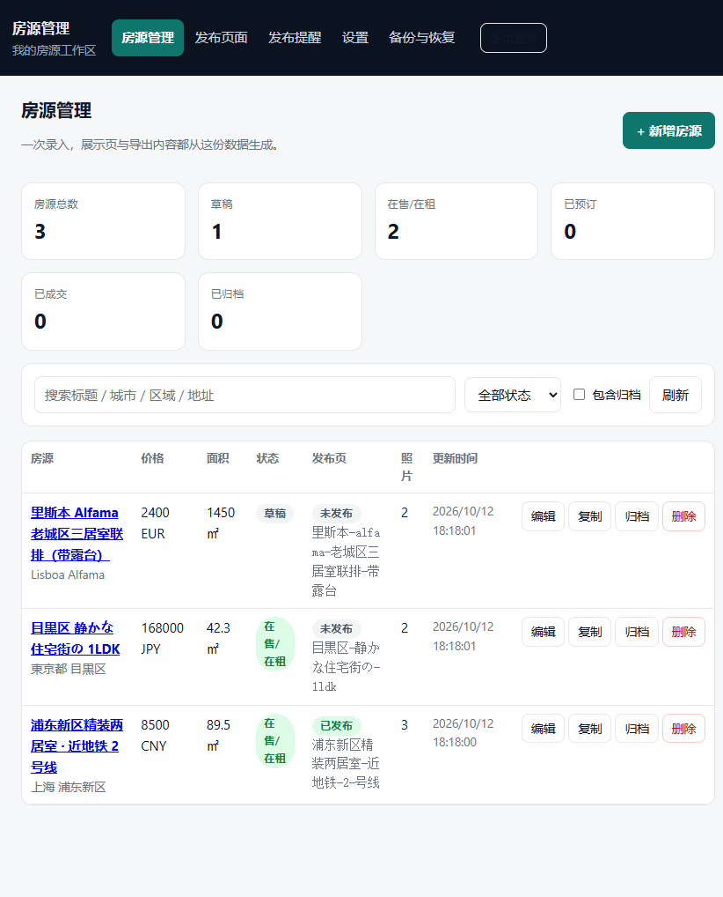
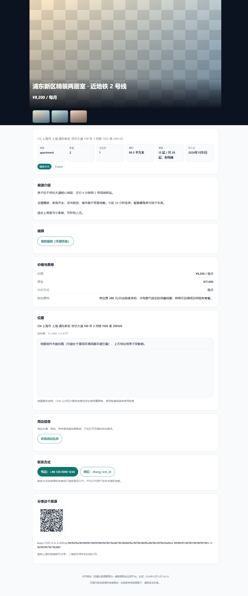
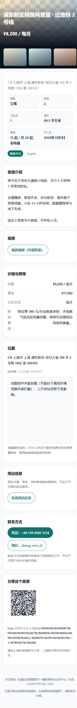

> **简体中文 | English**
>
> 轻量化房源管理与一键房源网站生成平台：录入房源、上传照片/视频，生成手机/桌面展示页，支持静态 HTML、地图、多语言和发布后提醒。
>
> **Lightweight Property Listing Manager**: enter a property, upload photos/video, generate responsive listing pages, static HTML export, maps, i18n and post-publish reminders.

---

# Lightweight Property Listing Manager / 轻量化房源管理

> **English** | [简体中文](#简体中文)
>
> A lightweight property listing manager and one-click listing-site generator: property entry, photo/video, shareable pages, static HTML export, maps, i18n and reminders.


## Screenshots / 截图





*Admin, desktop and mobile listing views from the repository evidence folder. / 仓库证据目录中的后台、桌面端和移动端房源页面。*


一次录入房源信息，上传照片与视频，即可生成手机/桌面自适应的可分享展示页，并支持静态 HTML 导出、地图定位、多语言、自定义域名与发布后的第 7/15 天提醒。

> **移动端优先**：手机是主要使用场景，所有页面（含后台管理）都按手机优先设计——底部菜单栏、可折叠信息区块、表格在窄屏自动变成卡片、保存按钮吸附在底部。桌面端只是加宽并换成顶部菜单/侧栏，结构完全一致，不做两套页面。

> **对外可租状态**：展示页主图左上角固定显示状态标签——**出租中**（绿）/ **已租**（灰）/ **未确认**（橙）。前两者由房东设置；「未确认」由系统按最后更新时间自动判定（默认超过 30 天未更新，见 `LISTING_STALE_DAYS`），避免房东长期不更新时页面仍显示「出租中」而误导访客。

本项目按《轻量化房源管理与一键房源网站生成平台_整合实施方案（归档稿 1.0）》实施，覆盖方案中的**第 0–8 阶段**。

---

## 1. 快速开始

### 环境要求

| 依赖 | 版本 | 说明 |
| --- | --- | --- |
| Node.js | **≥ 24** | 直接运行 TypeScript（原生类型擦除），**无需构建步骤** |
| pnpm | ≥ 9 | 也可使用 npm（见下方「已知环境适配」） |

数据库使用 Node 24 内置的 `node:sqlite`，**不需要**单独安装数据库服务。

### 安装与启动

```bash
pnpm install
cp .env.example .env      # 按需修改；生产环境必须改 ADMIN_PASSWORD 与 SESSION_SECRET
pnpm seed                 # 可选：写入 3 条演示房源（含自动生成的示例照片）
pnpm start                # 启动服务
```

启动后：

- 管理后台：<http://127.0.0.1:3210/admin/>
- 健康检查：<http://127.0.0.1:3210/healthz>

默认管理口令来自 `.env` 中的 `ADMIN_PASSWORD`（示例值 `admin12345`，**生产环境必须修改**）。

### 常用命令

| 命令 | 作用 |
| --- | --- |
| `pnpm start` | 启动服务（含定时提醒投递） |
| `pnpm dev` | 启动并监听文件变化自动重启 |
| `pnpm migrate` | 仅执行数据库迁移（启动时也会自动执行） |
| `pnpm seed` | 写入演示数据（已有房源时跳过，可用 `SEED_FORCE=true` 强制） |
| `pnpm smoke` | **73 项端到端冒烟检查**（登录→录入→上传→发布→公开访问→提醒→导出→备份恢复→撤下→删除） |
| `pnpm test` | 单元与集成测试 |
| `pnpm typecheck` | TypeScript 类型检查 |
| `pnpm reminders` | 手动执行一次提醒投递扫描 |

---

## 2. 功能概览

### 房源管理（第 1 阶段）

- 房源新增 / 编辑 / 复制 / 归档 / 删除，状态可切换（草稿、在售在租、已预订、已成交、已归档）
- 列表支持中文关键词搜索（标题、城市、区域、地址）、状态筛选、归档过滤
- 照片上传（JPG/PNG/WebP/GIF）与视频文件、外部视频链接；支持排序与指定封面
- 上传做**文件头魔数校验 + 扩展名交叉核对 + 大小/数量上限**，伪装文件会被拒绝
- 每个素材可记录「来源/授权说明」，便于商用前核对
- 标题与城市相同的房源会给出**疑似重复录入**提醒

### 展示页主图与对外状态（本轮新增）

- **主图自动轮播**：多张照片时每 4.2 秒自动切换，带页码（`3/5`）与圆点指示。
  用户一旦手动滑动、点击或鼠标悬停就**永久停止**自动播放，不跟用户抢控制权；
  系统开启「减少动效」（`prefers-reduced-motion`）或页面切到后台时同样不轮播。
- **主图状态标签**：固定在画面左上角、不随图片滚动，三种取值——
  **出租中**（绿）/ **已租**（灰）/ **未确认**（橙）。
- **顶部栏**：标题 + 语言切换（语言切换已从标题下方移到顶部，且只有存在译文时才出现）。
- **底部菜单栏**（仅手机）：房源 / 电话 / 分享 / 地图，与后台标签栏风格一致；桌面端改用顶部栏。

### 对外可租状态怎么来的

| 状态 | 来源 | 说明 |
| --- | --- | --- |
| 出租中 | 房东设置 | 新建房源默认值，房东可随时改 |
| 已租 | 房东设置 | 房东明确标记已租出；**优先级最高**，不再受陈旧度影响 |
| 未确认 | 系统自动 | 超过 `LISTING_STALE_DAYS` 天（默认 30）未更新即自动判定，页面同时给出提示文案 |

「未确认」**不允许手工设置**（接口会拒绝），只能由陈旧度推导，避免被当成万能挡箭牌；
判定基准是 `updated_at`，所以房东只要编辑一次房源（哪怕只改一个字）就会自动回到「出租中」。
后台列表同样显示推导后的状态，方便一眼看出哪些房源已经陈旧。

### 一键生成展示页（第 2 阶段）

- 自动生成唯一分享链接（支持中文 slug）与二维码（内联 SVG，可离线扫描）
- 手机与桌面自适应；发布 / 撤下可反复操作
- **未发布、已撤下、不存在的链接都返回完全一致的 404**，不泄露房源是否存在
- 后台改动**立即**反映到展示页（展示页永远从同一份数据实时渲染，无缓存副本）
- 「预览效果」可在发布前查看与公开页完全一致的渲染结果

### 模板与导出（第 3 阶段）

- 三套展示模板：现代卡片 / 经典稳重 / 极简文字
- 导出 `index.html` + `assets/` 图片 + 说明文件为 **ZIP 下载**或写入服务器目录
- 导出使用相对路径，**双击即可打开**，不依赖管理后台
- 多语言房源会导出多个 HTML 文件（`index.html`、`index.en.html` …）并互相链接，**离线也能切换语言**
- 不会导出会变成死链的查询入口

### 地图与周边信息（第 4 阶段）

- 地图为**项目自研实现**（约 120 行，见 `src/render/mini-map.ts`），支持拖拽平移、± 缩放与双指缩放，**不依赖任何第三方地图库**（因此也没有 Leaflet 之类的 BSD 许可组件）
- 瓦片使用 OpenStreetMap 公共瓦片服务，**无需任何密钥**；页面固定显示 `© OpenStreetMap contributors` 署名
- 周边交通/商店/学校等信息**按需加载**（点击「查看周边信息」才请求），不拖慢页面打开
- 地图库或瓦片不可用时，自动降级为地址文本 + 经纬度，**地址信息始终可见**
- 周边信息端点可通过 `MAP_OVERPASS_ENDPOINT` 替换为自建服务

### 多语言（第 5 阶段）

- 界面文案支持多语言词条（简体中文、繁體中文、English、日本語），未知语言回退英文
- 房源译文**单独存储**，切换语言**绝不会覆盖原文**
- 货币、日期、面积单位按配置格式化；面积支持平方米/平方英尺，计价支持总价/月/周/晚/年
- 拒绝用同语言「译文」覆盖原文，必须回到房源主记录修改

### 托管与自定义域名（第 6 阶段）

- 默认使用平台地址，可切换为自定义域名/子域名
- 绑定域名必须通过 **DNS TXT 记录完成所有权验证**；未验证前仍使用平台默认地址
- 换绑域名会要求重新验证；已被其它房源占用的域名会被拒绝

### 发布提醒（第 7 阶段）

- 发布后第 7 天提醒检查房源，第 15 天提醒确认或更新，时刻为配置时区的**当地上午 9 点**
- 提醒天数与重试上限通过环境变量配置，时区在工作区设置中修改
- 幂等键保证**不会重复通知**；失败按指数退避重试并记录原因；深夜里不发送
- 展示页撤下后，未发送的提醒**自动关闭**
- 可用 `DEV_TIME_TRAVEL=true` 在浏览器里直接推进业务时间验证规则，**无需真实等待 7/15 天**

### 安全与上线准备（第 8 阶段）

- CSP 采用 per-request nonce（脚本不放宽 `unsafe-inline`）、`X-Frame-Options: DENY`、`nosniff`、Referrer-Policy
- 会话为 HMAC 签名的 HttpOnly Cookie，口令恒定时间比较，登录失败限流
- 全部 SQL 使用参数绑定；页面输出统一转义（含标题/描述等用户可输入字段）
- 密钥只从环境变量读取，界面上只显示「是否已设置」；带疑似密钥字段的配置会被服务端拒绝保存
- 备份包含 SQLite 一致性快照与全部素材，并提供**恢复演练**（解包到独立目录并逐表校验行数）

---

## 3. 项目结构

```
├─ src/
│  ├─ domain/        纯领域模型与规则（零 IO，可单测）
│  ├─ db/            SQLite 连接、迁移、仓储
│  ├─ adapters/      可替换适配层：clock / map / storage / mail / dns / hosting
│  ├─ services/      业务服务：房源、媒体、发布、导出、提醒、i18n、托管、备份、审计
│  ├─ render/        展示页渲染、模板、内置地图、图标、二维码、HTML 转义
│  ├─ http/          Fastify 应用装配、安全层、路由
│  ├─ util/          时间（IANA 时区）、slug、日志、ID、ZIP 打包/解包
│  ├─ config.ts      配置加载与校验
│  ├─ app-context.ts 组合根
│  └─ server.ts      入口
├─ public/admin/     后台管理界面（原生 ES Module，无需构建，手机优先；含自研 SVG 图标）
├─ demo/photos/      演示用真实照片（CC0 公共领域）+ ATTRIBUTION.json 署名清单
├─ tests/            单元测试 + 集成测试
├─ scripts/          seed / smoke / export-once / serve-static
├─ docs/             方案文档、许可证归档、各阶段验收报告、证据截图
└─ var/              运行期数据（数据库、上传素材、备份、导出），已在 .gitignore 中排除
```

依赖方向始终向内：`http → services → domain`，`db`/`adapters` 只被 `services` 依赖，`domain` 不依赖任何外部模块。

---

## 4. 数据模型

单库 SQLite，共 10 张表。迁移是只增不改的，当前已应用到 **v2**：`v1 initial_schema`、`v2 property_availability_status`（新增对外可租状态列）。

| 表 | 说明 |
| --- | --- |
| `workspaces` | 工作区：默认语言、币种、面积单位、时区、托管方式 |
| `users` | 成员与角色（owner / manager / viewer） |
| `properties` | 房源主表（**唯一数据源**）。`status` 是内部状态（草稿/在售在租/已成交/已归档），`availability_status` 是对外可租状态（出租中/已租），「未确认」不落库、按 `updated_at` 实时推导 |
| `property_translations` | 译文，按 `(property_id, locale)` 唯一 —— 与原文分离 |
| `contacts` | 联系方式，含 `is_public` 公开策略 |
| `media` | 照片 / 视频文件 / 外部视频链接，含排序、封面标记、来源说明 |
| `listing_pages` | 发布页：slug、语言、模板、状态、自定义域名与验证信息 |
| `reminders` | 提醒：类型、计划时间、时区、状态、尝试次数、幂等键 |
| `external_service_configs` | 外部服务非敏感配置 + **密钥的环境变量名**（不存密钥） |
| `audit_logs` | 审计日志 |

金额带 `currency`、面积带 `area_unit`、时间带 `timezone` —— 不写死任何国家的规则。

---

## 5. 配置

完整清单见 [`.env.example`](.env.example)。关键项：

| 变量 | 默认值 | 说明 |
| --- | --- | --- |
| `PORT` / `HOST` | `3000` / `127.0.0.1` | 监听地址 |
| `PUBLIC_BASE_URL` | `http://127.0.0.1:3000` | 生成分享链接与二维码的根地址，生产必须改为真实域名 |
| `ADMIN_PASSWORD` | 示例值 | 后台口令，**生产环境强制校验不得为默认值** |
| `SESSION_SECRET` | 示例值 | 会话签名密钥，至少 32 字符 |
| `DEFAULT_LOCALE` / `DEFAULT_CURRENCY` / `DEFAULT_AREA_UNIT` / `DEFAULT_TIMEZONE` | `zh-CN` / `CNY` / `square_meter` / `Asia/Shanghai` | 新建房源默认值与格式化依据 |
| `MAX_UPLOAD_BYTES` / `MAX_PHOTOS_PER_PROPERTY` / `MAX_VIDEO_BYTES` | 15 MB / 30 / 200 MB | 上传上限 |
| `MAP_PROVIDER` | `osm` | `osm` 使用内置地图 + OSM 瓦片；`disabled` 完全关闭地图 |
| `MAP_OVERPASS_ENDPOINT` | 公共实例 | 周边信息端点，可按地区替换 |
| `MAIL_PROVIDER` | `console` | `console` 只写日志；`smtp` 走真实 SMTP（支持隐式 TLS 与 STARTTLS） |
| `HOSTING_PROVIDER` | `default` | `custom_domain` 才启用自定义域名绑定 |
| `REMINDER_DAY_1` / `REMINDER_DAY_2` / `REMINDER_MAX_ATTEMPTS` | 7 / 15 / 3 | 提醒规则 |
| `REMINDER_RECIPIENT` | 空 | 留空则使用 `OWNER_EMAIL` |
| `LISTING_STALE_DAYS` | `30` | 超过多少天未更新房源，展示页就把状态标为「未确认」；设为 0 关闭自动判定 |
| `DEV_TIME_TRAVEL` | `false` | 演示用可控时钟，**生产环境自动禁用** |

`NODE_ENV=production` 时会强制校验：不得使用默认口令、`SESSION_SECRET` 不得为示例值且长度 ≥ 32、`PUBLIC_BASE_URL` 必须为 https。

---

## 6. 验证方式

方案第六章第 4 条要求「必须通过真实浏览器操作验证用户路径」。本项目用三层验证：

```bash
pnpm typecheck     # 类型检查
pnpm test          # 单元 + 集成测试
pnpm smoke         # 73 项端到端检查（进程内真实 HTTP 链路）
```

此外还完成了**真实浏览器验证**，截图归档在 [`docs/evidence/`](docs/evidence)：登录、房源列表、房源编辑、展示页（桌面/手机）、英文展示页、地图真实渲染、提醒投递、备份恢复演练、表单校验、发布页、设置页、离线导出独立打开等。

各阶段验收结论见 [`docs/reports/`](docs/reports)。

---

## 7. 生产部署与回滚

**上线前必做**

1. `NODE_ENV=production`，设置强口令与随机会话密钥（`node -e "console.log(crypto.randomUUID()+crypto.randomUUID())"`）
2. `PUBLIC_BASE_URL` 改为 https 真实域名
3. 由反向代理（Nginx / Caddy）终结 TLS 并提供 HTTPS —— 应用自身不做 TLS 终结
4. 配置 `MAIL_PROVIDER=smtp` 并填入真实 SMTP 参数，否则提醒只写日志
5. 明确地图与周边信息服务的免费额度与超额费用；商用前阅读 OSM 瓦片使用政策
6. 核对 [`docs/licenses.md`](docs/licenses.md) 中的许可证与素材授权
7. 设置好备份目录并验证一次恢复演练

**启动与回滚**

```bash
# 启动（迁移在启动时自动执行）
NODE_ENV=production node --disable-warning=ExperimentalWarning src/server.ts

# 回滚：恢复上一版代码后重启即可。
# 数据库迁移是追加式的，且每个迁移在独立事务中执行 —— 失败会自动回滚。
```

备份与恢复：

- 后台「备份与恢复」可创建备份（SQLite 快照 + 全部素材）、校验归档、执行恢复演练
- 恢复演练解包到 `var/restore-drill/` 并逐表校验行数，**不影响正在运行的数据库**
- 真正切换时把该目录内容替换 `var/` 并重启服务

---

## 8. 已知限制

这些限制已在验收报告中登记，**未按「已完成」报告**：

1. **SMTP 适配器未对真实邮件服务器投递过** —— 已实现（`node:net`/`node:tls`，支持隐式 TLS 与 STARTTLS），但常规运行使用 `console` 适配器，邮件内容只写入服务端日志。
2. **周边信息未用真实数据验证** —— Overpass 端点可配置（`MAP_OVERPASS_ENDPOINT`），但本机环境对该公共实例的请求一律返回 HTTP 406（判断为网络策略拦截），因此只验证了降级路径。
3. **自定义域名验证未在真实公网 DNS 上跑通** —— 无自有域名；完整流程（绑定 → 添加 TXT → 验证 → 生效）已用可注入的 DNS 适配器覆盖测试。应用不做 TLS 终结，也无 HSTS。
4. **演示照片不是真实房源素材** —— `demo/photos/` 里的 15 张 CC0 照片仅用于展示界面效果，与演示房源本身没有对应关系；真实发布房源时应替换为权利人自己拍摄或已获授权的照片。
5. **地图为自研最小实现** —— 支持拖拽平移、缩放与定位，但不含路径规划、街景、批量标注等高级能力；瓦片可用性依赖 OpenStreetMap 公共服务及其使用政策。
6. **12 种可选语言中只有 4 种有界面文案目录**（zh-CN / zh-TW / en / ja），其余回退英文；后台管理界面目前只有中文。
7. **自由文本字段没有翻译通道**（详细地址、附加费用说明等），只显示原文 —— 这是有意设计：译文表只覆盖标题与描述，绝不覆盖原文。
8. **备份未加密且只存本机**，需要自行加密并同步到异地。
9. `formatDateOnly` 以 UTC 渲染纯日期字段（不涉及时刻，因此不含时区歧义，但与其它时间的展示口径不同）。
10. **未做依赖漏洞审计与性能压测**；仅消除了列表接口的 N+1 查询。

---

## 9. 已知环境适配

在 **exFAT** 卷上（本项目开发环境即如此）会碰到两个问题，已做适配：

1. exFAT 不支持符号链接与硬链接，pnpm 默认的 isolated linker 会失败 —— 因此仓库内提供了 `.npmrc`（`node-linker=hoisted`）。也可改用 `npm install`。
2. Node 的测试运行器在本版本中**不展开目录参数**，`node --test tests/` 会被当作文件而报 `MODULE_NOT_FOUND` —— 因此 `pnpm test` 使用 glob：`node --test "tests/**/*.test.ts"`。

---


---

## 10. 作者与品牌

本项目由 **智睿（ZHIRAI）** 独立开发。

| | |
| --- | --- |
| 品牌 | ZHIRAI / 智睿科技 |
| 定位 | 个人品牌 · 独立开发者 · 个人技术工作室 |
| Slogan | Build Ideas Into Reality（把想法变成现实） |
| 官网 | <https://zhirai.cloud> |
| 技术支持 | <xtang3125@gmail.com> |
| 商务 / 项目合作 | <txq@zhinian-ai.com> |
| Discord | <https://discord.gg/uQRzb53R> |
| QQ 群 | 147594586 |

© 2026 智睿科技 保留所有权利。

---

## 11. 第三方组件与许可

**运行期依赖全部为 MIT 许可**：`fastify`、`@fastify/cookie`、`@fastify/multipart`、`@fastify/static`、`qrcode-generator`（MIT，Kazuhiko Arase；"QR Code" 为 DENSO WAVE 商标）。

按「只直接引入 MIT 组件，其余仅作参考」的约定：地图改为**自研实现**（原先的 Leaflet 为 BSD-2-Clause，已移除），`typescript`（Apache-2.0）**仅作开发期类型检查**，不随运行期产物分发。

**界面图标为项目自行绘制的内联 SVG**（`src/render/icons.ts` + `public/admin/icons.js`），
不使用表情符号，也不引入任何第三方图标库 —— 因此不涉及额外的图标授权与署名。
两份实现必须保持路径数据一致，由 `tests/domain/icons.test.ts` 断言；
该测试同时会扫描界面源码，一旦再次出现表情符号即失败。

演示照片为 **CC0 1.0 公共领域**作品，来自 Wikimedia Commons 的 Unsplash 导入集合，署名清单见 [`demo/photos/ATTRIBUTION.json`](demo/photos/ATTRIBUTION.json)。**这 15 张图仅用于本地演示与界面评估**，真实发布房源时应替换为权利人自己拍摄或已获授权的照片。

第 0 阶段核查的候选开源项目（PropertyWebBuilder、MicroRealEstate、OpenProperty、单房源模板类仓库）的许可证状态与取舍理由，见 [`docs/phase0-decision-record.md`](docs/phase0-decision-record.md) 与 [`docs/licenses.md`](docs/licenses.md)。**该归档是 2026-10-12 的快照，商用前必须重新核验。**